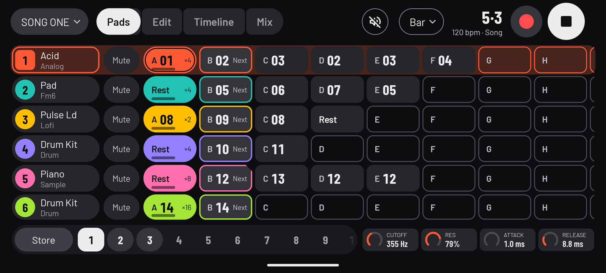
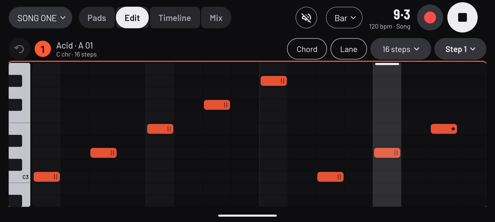
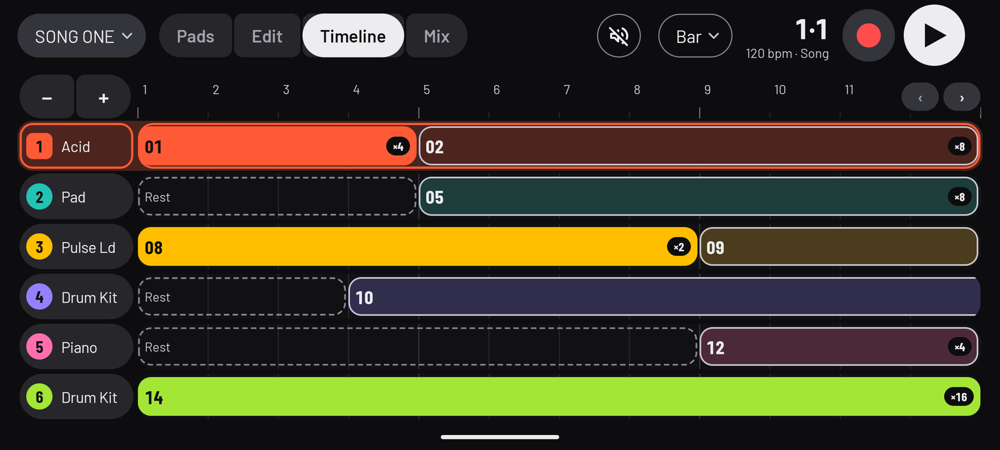
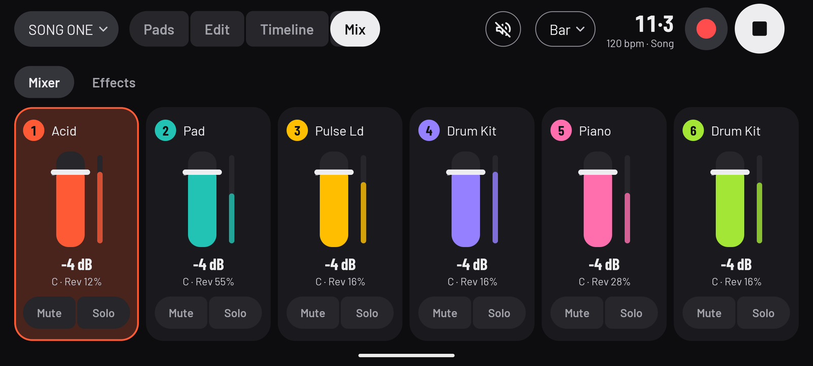
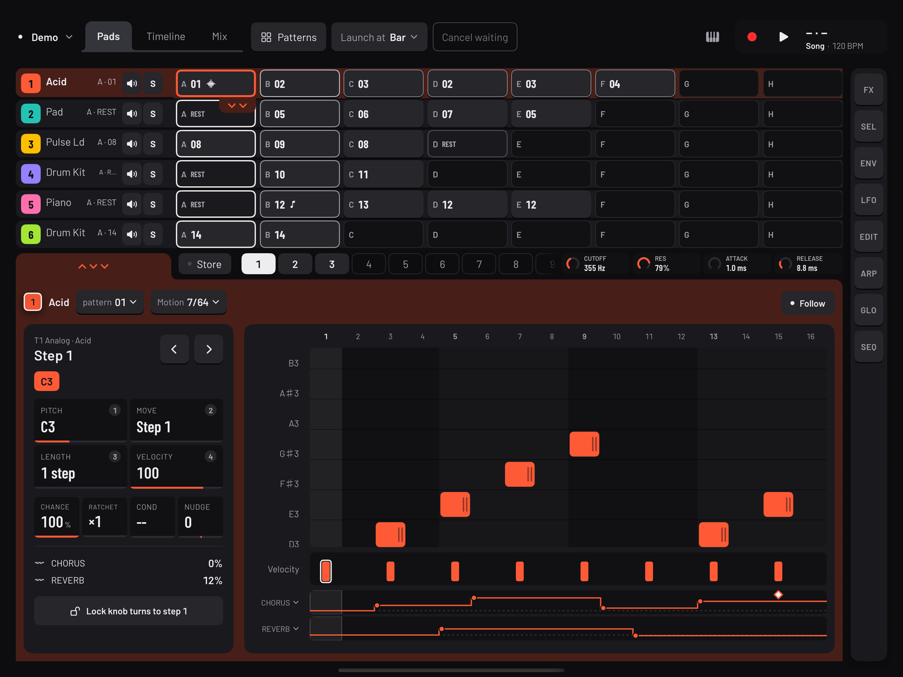
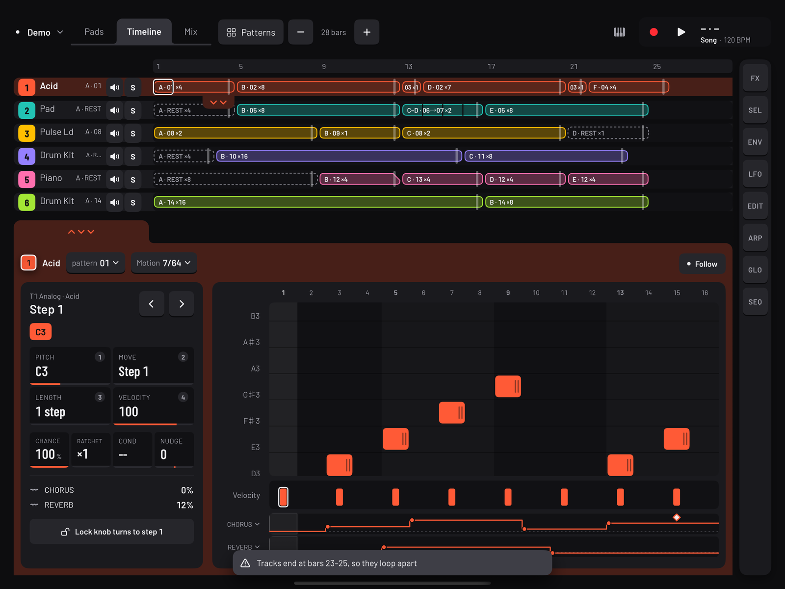

# Lupe (fm1-ipad)

An app for the M-VAVE FM-1 running [Skiff](https://github.com/illuminus5/skiff), on iPad, iPhone and Android phones. The two work as one instrument. The FM-1 makes the sound, stores the patterns and plays them. The app is a bigger window onto it: it shows all six tracks, edits them, shapes sounds, records samples, and arranges each track's patterns into a song. On a phone the same jobs come one screen at a time.

It's a work in progress. I test it with my own FM-1, an iPad, a Pixel 7 and a Pixel 10 Pro.

## Screenshots

Lupe for Android 0.3.0, running the demo FM-1:

<p>


</p>
<p>


</p>

The iPad app, built from today's source and running the demo FM-1:

<p>


</p>

Lupe began on [SLOOP](https://github.com/isod89/sloop-fm1) and spoke both firmwares until 2026-11-15, when it became Skiff-only. The last SLOOP state is the tag `sloop-archive-2026-11-15`; `design/archive/sloop.md` lists what went.

## What you need

- An FM-1 on Skiff 2.5.1 or 2.6, and a USB-C cable from it to the phone or iPad
- **Android:** a phone on Android 13 or later with a USB-C port
- **iPad:** iPadOS 18 or later. The layout is drawn for a 13-inch iPad in landscape and scaled to fit smaller ones
- **iPhone:** iOS 18 or later, used in landscape. An iPhone 15 or later plugs straight into the FM-1; an older one needs Apple's Lightning to USB camera adapter

**Which Skiff.** Stock Skiff 2.5.1 or 2.6 is enough to edit everything (Android 0.2 and later, and the iPad and iPhone app built from today's source; Android 0.1 needs 2.5.1). For the app to follow the FM-1's screen (open the page you're on, show the step cursor, the levels and the scope), the FM-1 needs **Skiff-Lupe 2.5.1**. That's Skiff 2.5.1 with a small screen link added, plus a fix for crackle when the FM-1's USB audio plays through an Android phone. The app can install it for you. Details and fingerprints are in [FIRMWARE.md](FIRMWARE.md).

## Install on Android

1. On the phone, open [Lupe for Android 0.3.0](https://github.com/sgerstl/fm1-ipad/releases/tag/lupe-android-0.3.0) and download `Lupe-0.3.0-android.apk`. Newer builds are listed under [Releases](https://github.com/sgerstl/fm1-ipad/releases) as "Lupe for Android".
2. Open the file. Android asks you to allow installs from that source (your browser or the Files app). Allow it, go back, and install.
3. Plug in the FM-1 and switch it on. If Android asks whether Lupe may use the FM-1, allow it.

No FM-1 to hand? The first screen offers a demo FM-1 so you can look around.

When the FM-1 runs stock Skiff or M-VAVE's firmware, Lupe offers to install Skiff-Lupe 2.5.1 over the same cable. It backs up the FM-1 first, downloads the file from this repo's releases and checks its fingerprint before writing. On Skiff 2.6 that's a step back to 2.5.1, and the offer says so: CAST goes, your projects stay. Tested on a Pixel 7 with a real FM-1, including finishing an install that was cut off. If you'd rather use a computer, Skiff's own installer works with Python 3:

1. Download `Skiff-Lupe-2.5.1.fwsc` from the [`lupe-firmware-2` release](https://github.com/sgerstl/fm1-ipad/releases/tag/lupe-firmware-2).
2. Get Skiff's `tools/` folder by downloading or cloning [illuminus5/skiff](https://github.com/illuminus5/skiff).
3. Plug the FM-1 into the computer and run:

```bash
pip install mido python-rtmidi
python tools/fm1_install.py Skiff-Lupe-2.5.1.fwsc
```

It takes about two minutes, and the FM-1 restarts on Skiff-Lupe. Back up your music first, in the [Skiff installer](https://illuminus5.github.io/skiff/webapp/installer/) or Skiff's web editor. Skiff's [README](https://github.com/illuminus5/skiff#install) covers the way back to the official firmware.

## Install on iPad or iPhone

There's no App Store version yet. You build it yourself in Xcode on a Mac, signed with a free Apple ID. Apps signed that way stop opening after 7 days, so build again to renew it. [TESTING.md](TESTING.md) walks through it, from backing up the FM-1 to the first run.

**To try it, start with [TESTING.md](TESTING.md).**

## Layout

| Path | What |
|---|---|
| `ios/` | The app for iPad and iPhone (SwiftUI, CoreMIDI) and `SloopKit`, the Swift package that speaks to the FM-1. See `ios/README.md` |
| `android/` | The Android app (Jetpack Compose) over the same Swift code, built with the Swift SDK for Android. See `android/BRIDGE.md` |
| `skiff/` | Skiff's screen-link patch and how the Skiff-Lupe packages are built |
| `firmware/releases/` | The Skiff-Lupe packages Lupe downloads, with their notes (`FIRMWARE.md`) |
| `sloop/` | History: SLOOP 2.8.4's screen-link patch (Lupe no longer speaks SLOOP) |
| `vendor/sloop-2.8.4/` | History: stock SLOOP 2.8.4 and its editor protocol, where the app's framing and shared commands come from |
| `protocol/` | The editor commands the app uses |
| `tokens/` | `tokens.json`: the track and knob colours, and the app's surfaces |
| `qa/` | The test plan and the last pass |
| `tools/` | Small Mac command-line probes for the FM-1's MIDI |
| `design/` | Design boards, decisions and the app icon |

An earlier plan replaced the FM-1's firmware with my own fork of M-VAVE's FM1 Open. It's archived at the tag `archive/fm1-open-firmware` and the `slice-1-link` branch.

## Licence

GPL-3.0 (see `LICENSE`), the same as Skiff and SLOOP. The app is written from the firmwares' published editor protocols, and some parts come from the firmware's own code. The installer follows Skiff's `fm1_install.py` and `fm1ota.js`, and the parameter tables follow `params.c`. Newer Android builds also draw the FM-1's pages with Skiff's own drawing code. The screen-link patches in `skiff/` and `sloop/` and the firmware packages are GPL-3.0 as derivatives, and Skiff-Lupe's source is in [sgerstl/skiff](https://github.com/sgerstl/skiff). The files in `vendor/sloop-2.8.4/` are SLOOP's, under its own `LICENSE` and `LICENSING.md`. `android/THIRD_PARTY.md` lists the Android app's fonts and icons.

Skiff is by illuminus5, a fork of [Felucca](https://github.com/hugelton/Felucca) by Leo Kuroshita (Hügelton Instruments). All credit for the firmware is theirs.
