# Arrange on Skiff (2026-11-05)

The iPad's Arrange tab on Skiff 2.0+, in the demo (`-demo -demo-skiff -page song`), against the canvas's board A ([Jib Skiff Song Structure](https://claude.ai/artifact/NWuJFXxWQN6wPwWo9s1xVk)). FakeSkiff holds board A's song. iPad Air 13-inch simulator, scaled to 1600 px wide.

| | |
|---|---|
| 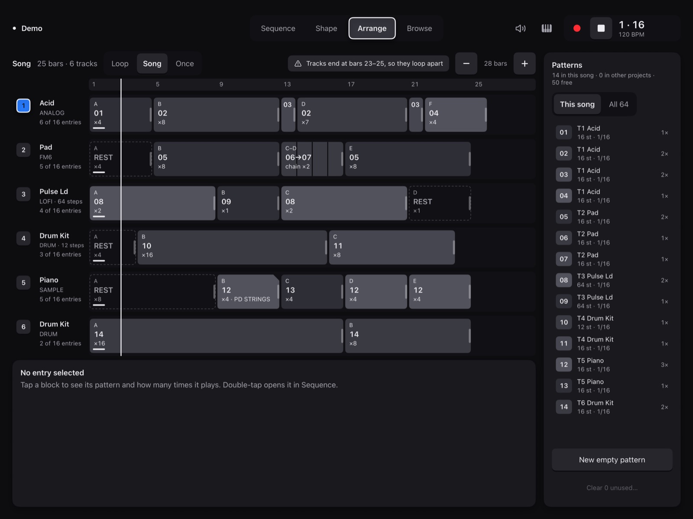 | **01** Board A's song, flat look (medium). The demo plays, so the playhead moves; FakeSkiff doesn't advance entries, so the line and the entries' "playing" bars disagree. |
| 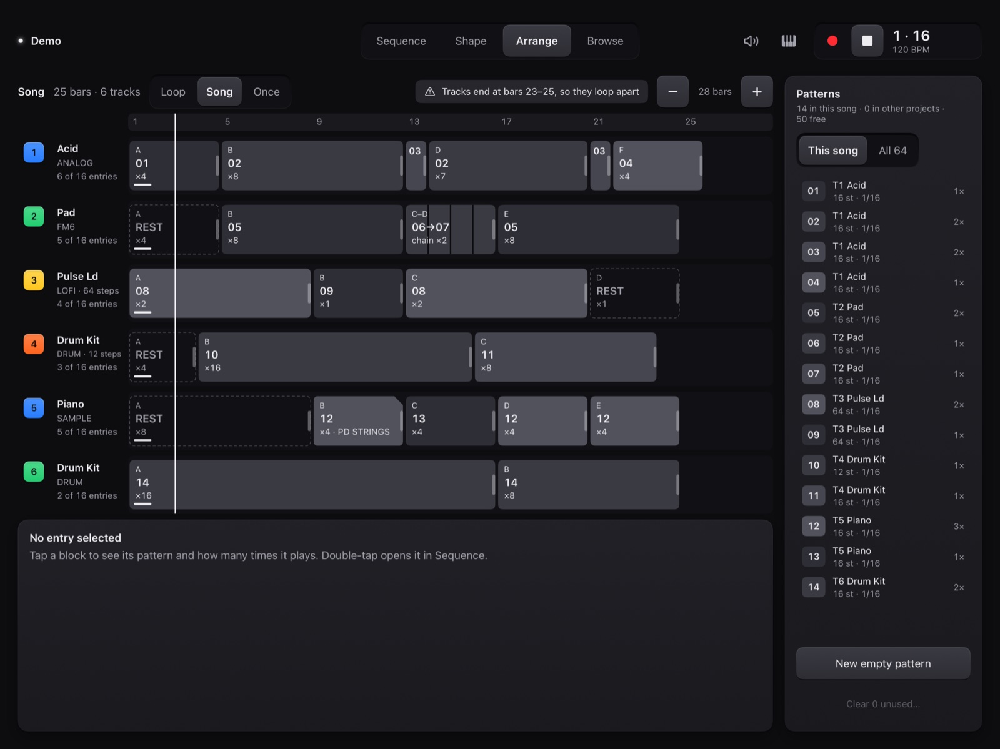 | **02** The same, physical look. |
| 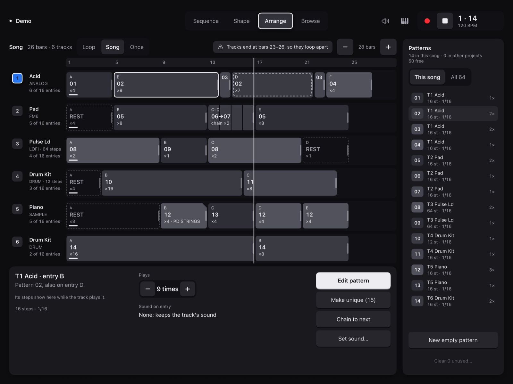 | **03** Entry B selected (ring, its linked copy D ringed dashed), the inspector, Plays raised to 9 while playing: B is ahead of the playhead, so Skiff takes it. |
| 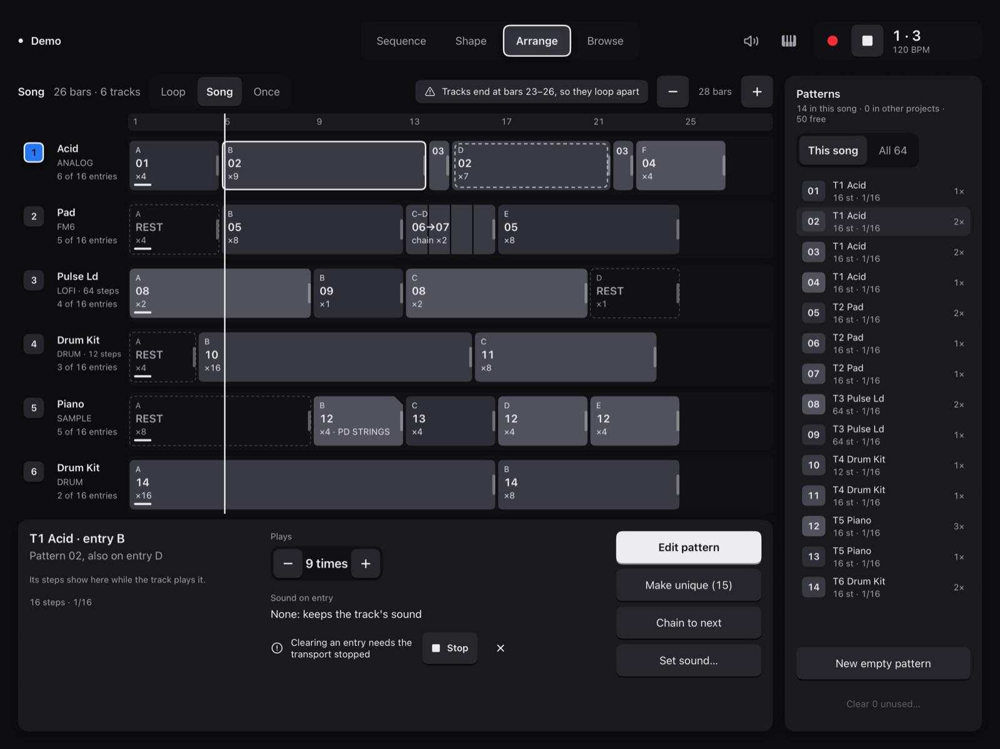 | **04** Delete entry from the hold menu while playing: refused before anything is sent, said in the inspector, with Stop. |
| 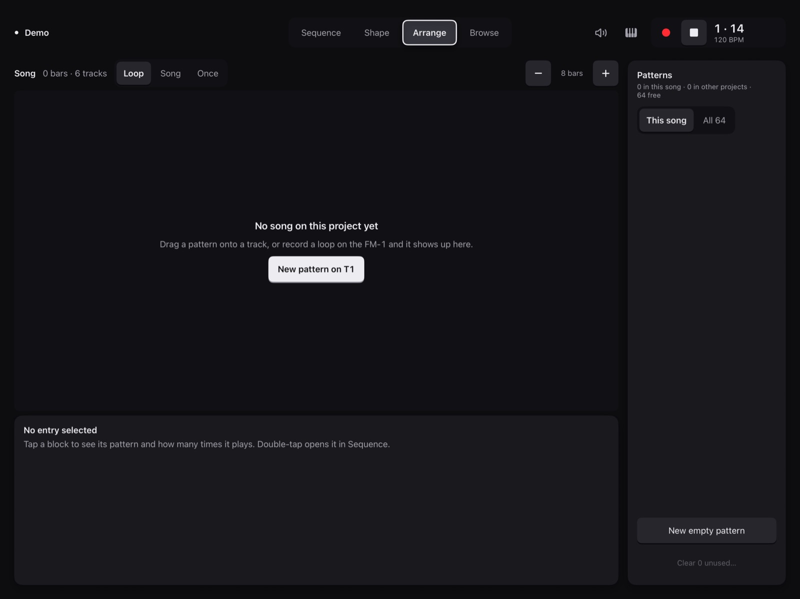 | **05** No song yet (`-demo-song empty`). |
| 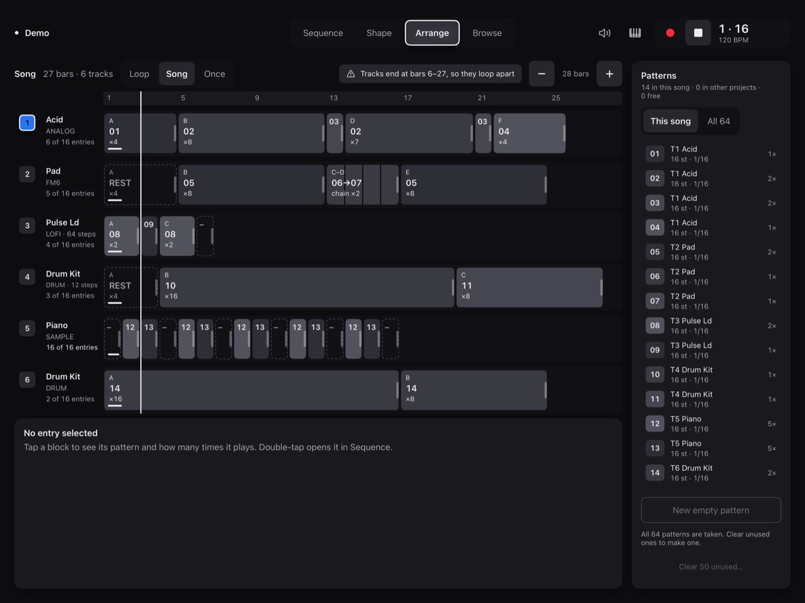 | **06** T5 with all 16 entries and the pool full (`-demo-song full`): New empty pattern disabled with the reason, Clear unused offered (off while playing). |
| 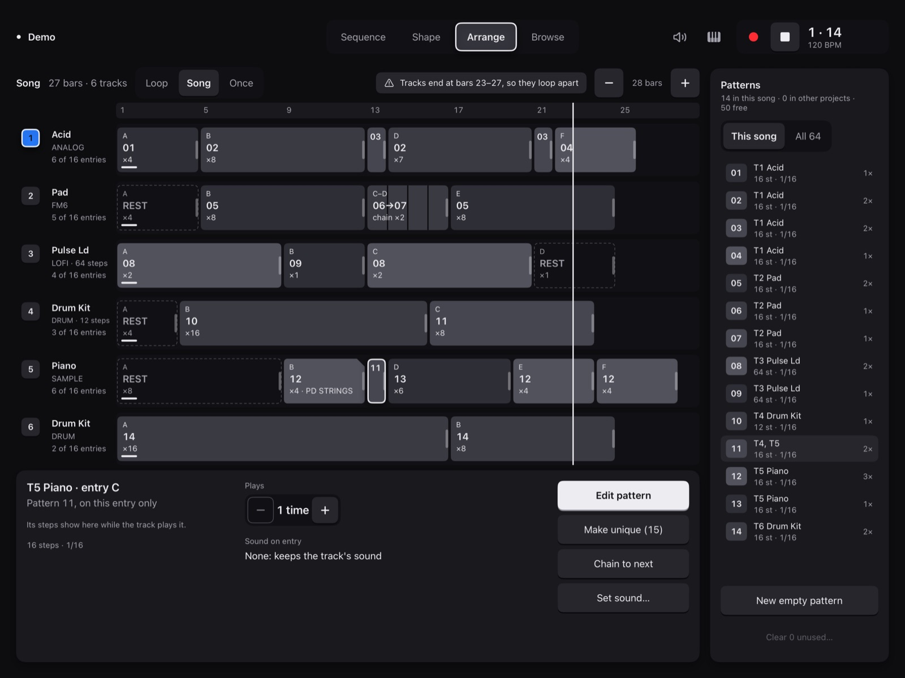 | **07** Pattern 11 dragged from the bin onto T5 at bar 13: a new entry C, the rest moved on. |
| 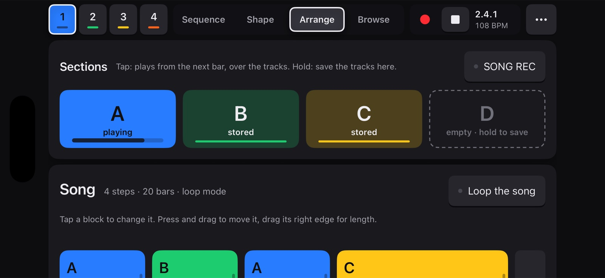 | **08** The iPhone: Arrange on Skiff is on the iPad for now (step 6 isn't designed). |

Not shown: the disconnected state (FakeSkiff can't be unplugged), the drag in progress (insertion line, ghost and its sentence: seen in the simulator, not kept), the hold menu, the tap-after-last menu.

## Colour (Scott: "the arrange page needs color")

Each lane in its track's colour, three ways compared. **Scott picked solid (2026-11-05)**; the switch and the other two are gone.

| Track colour (solid) | Tinted | Grey (the spec's) |
|---|---|---|
| 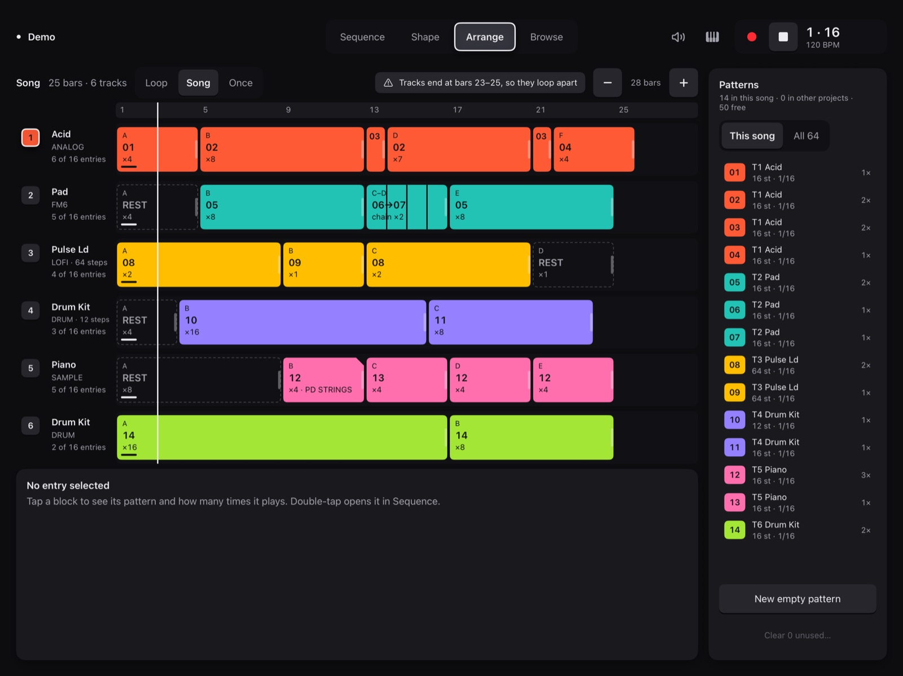 | 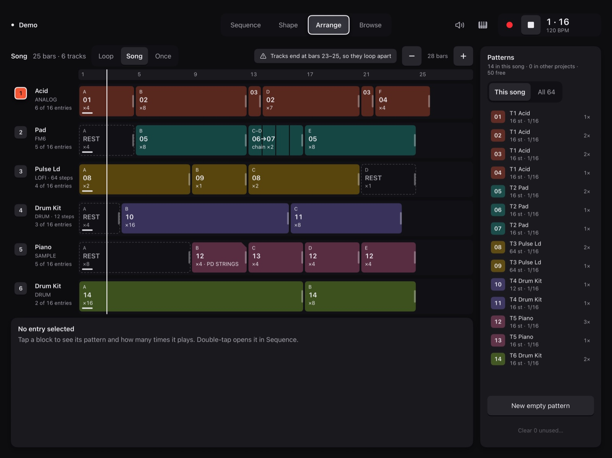 | 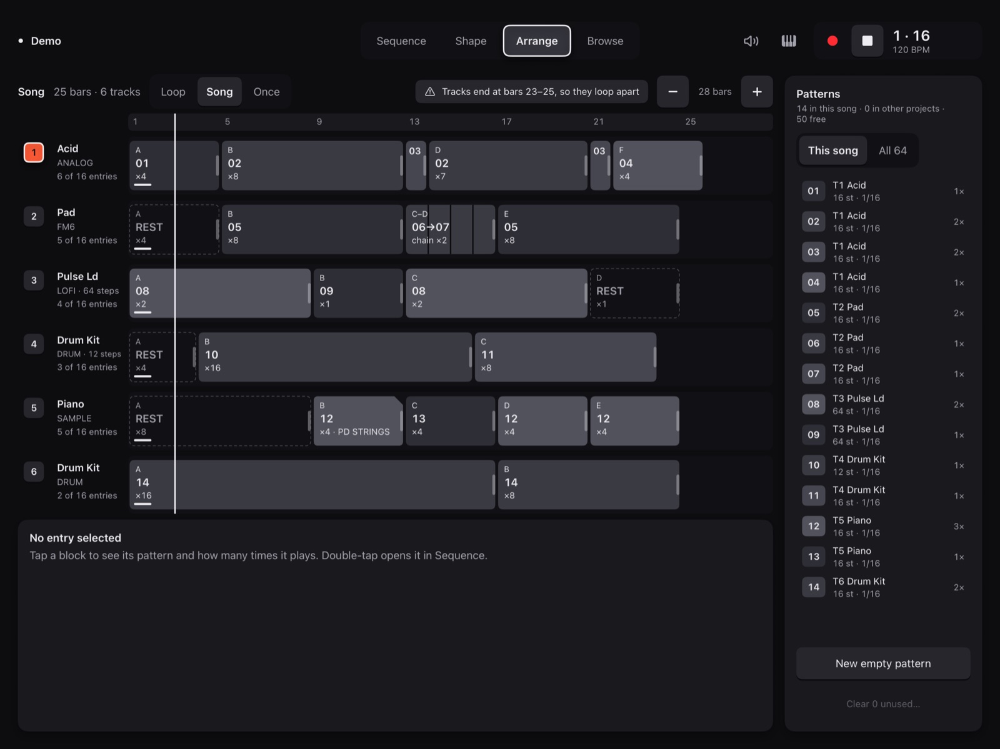 |

On solid, all block text is the dark onColour (6:1 or better on each of Skiff's six), the selection ring sits outside the block on the lane (a light ring on amber or lime would be under 3:1), and linked copies' dashes are dark.
