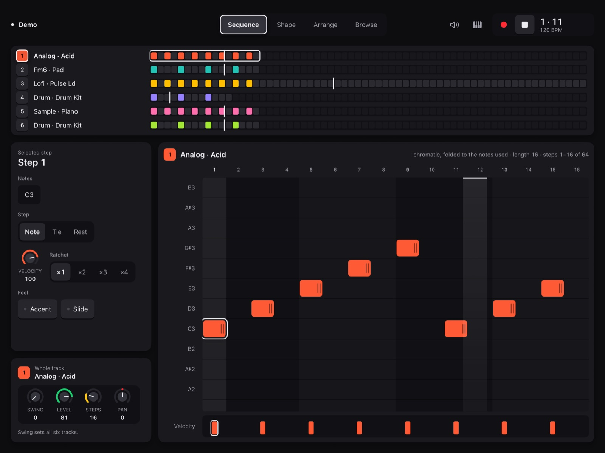
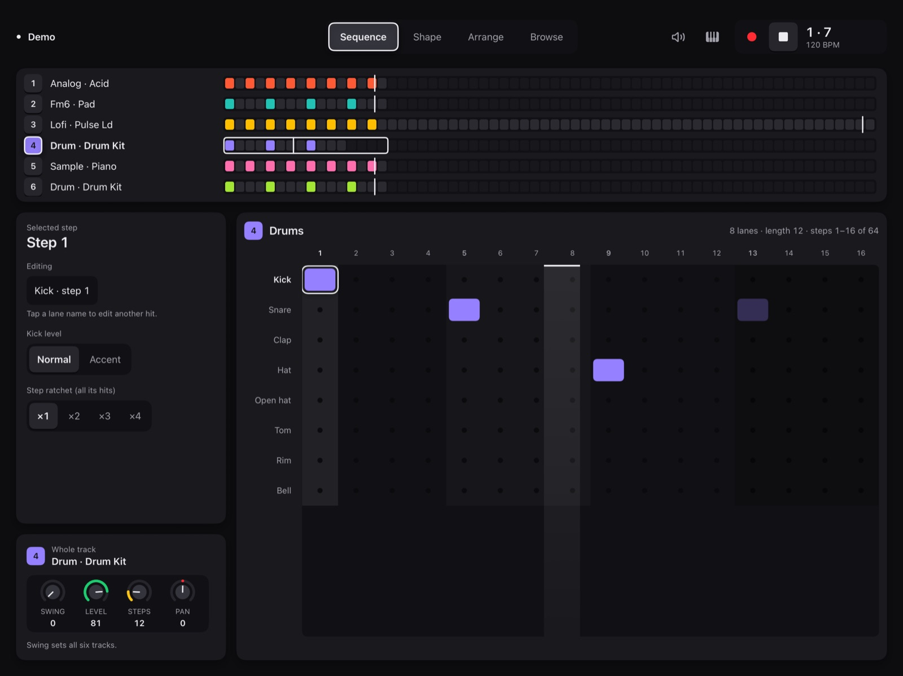
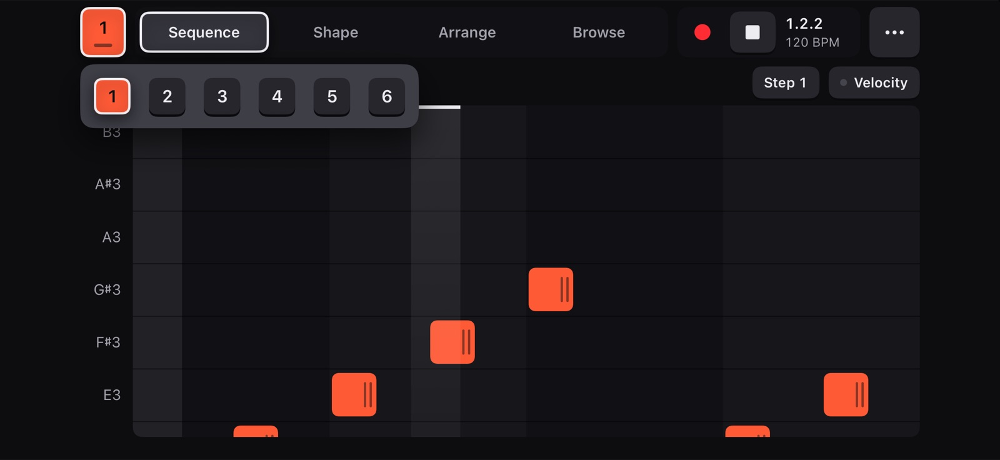

# Skiff's six tracks: Scott's three layout answers (2026-11-05)

In the demo (`-demo -demo-skiff`), flat look, simulators scaled to 1600 px.

| | |
|---|---|
|  | **01** The iPad's track box with six tracks: the same height as SLOOP's four, rows about 30 pt (cells 16 pt). A tap on a row selects the track. |
|  | **02** T4 on DRUM: Jib's drum grid with Skiff's 8 lanes. The demo's notes show on the lane each strikes (Skiff's own table); the step panel offers Normal / Accent and the step's ratchet, as Skiff keeps them. |
|  | **03** The iPhone: one chip, the current track's; a tap opens the six beside the finger (elevation 3), the current one lit and ringed. SLOOP's four tracks keep their four chips. |
